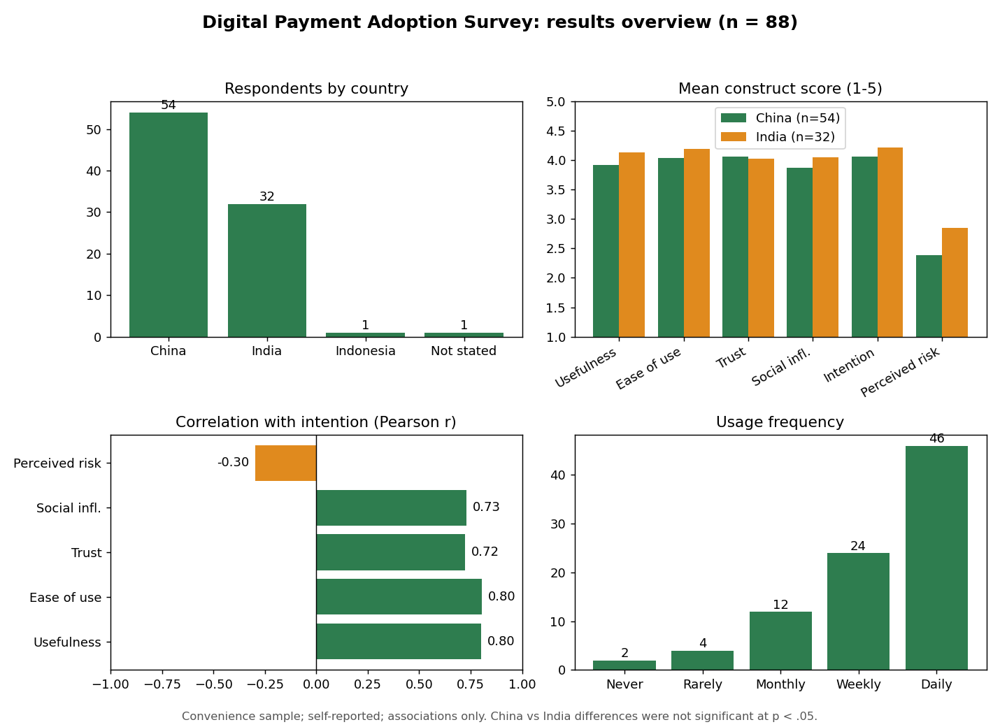

# Digital Payment Adoption Survey Data

Anonymized survey data for the paper "Factors Influencing the Adoption of Digital Payment Systems Among University Students: A Comparative Study of China and India" (Kashish Singh, Independent Researcher, preprint, October 2026).

## Paper

- SSRN: https://papers.ssrn.com/sol3/papers.cfm?abstract_id=7630318
- Zenodo (DOI): https://doi.org/10.5281/zenodo.23400747
- ORCID: https://orcid.org/0009-0003-4553-6458

## About the data

- Method: anonymous online survey (Google Form), 21 questions on 5-point scales
- Collected: 28-30 September 2026
- Responses exported: 100
- Analysis sample: 88 (54 studying in China, 32 in India, 1 Indonesia, 1 country not stated). 5 incomplete and 7 straight-lined responses were removed; no answers were edited or imputed.
- Sampling: convenience/snowball sample. Results show associations only and do not represent all students in China or India.
- Privacy: no names or emails are included. Exact submission times were removed; only the date is kept.

## Data quality notes

- Four responses (Same-batch flag = Yes) were submitted within a short window on 29 September and are flagged.
- Some respondents gave highly uniform answers, for example the same rating on all positively worded items. These responses were retained and are not flagged, so users may wish to run their own sensitivity checks.

## Files

- `survey_data.csv`: anonymized survey responses with construct scores
- `questionnaire_and_codebook.pdf`: questionnaire items, scoring and reliability
- `results_overview-1.png`: results overview figure (generated from the survey data)
- `CITATION.cff`: citation metadata
- `LICENSE`: CC BY 4.0

## Constructs (mean of items)

- Usefulness: Q1-Q3
- Ease of use: Q4-Q6
- Trust: Q7, Q10, Q13
- Social influence: Q8, Q9
- Intention: Q11, Q12
- Perceived risk: Q14-Q16 (higher = more concern)

Usage frequency is scored Never=1, Rarely=2, Monthly=3, Weekly=4, Daily=5.

## How to cite

Singh, K. (2026). Factors influencing the adoption of digital payment systems among university students: A comparative study of China and India [Preprint]. SSRN. https://papers.ssrn.com/sol3/papers.cfm?abstract_id=7630318. Zenodo: https://doi.org/10.5281/zenodo.23400747

## License

Data released under CC BY 4.0. Please cite the paper if you use this data.
